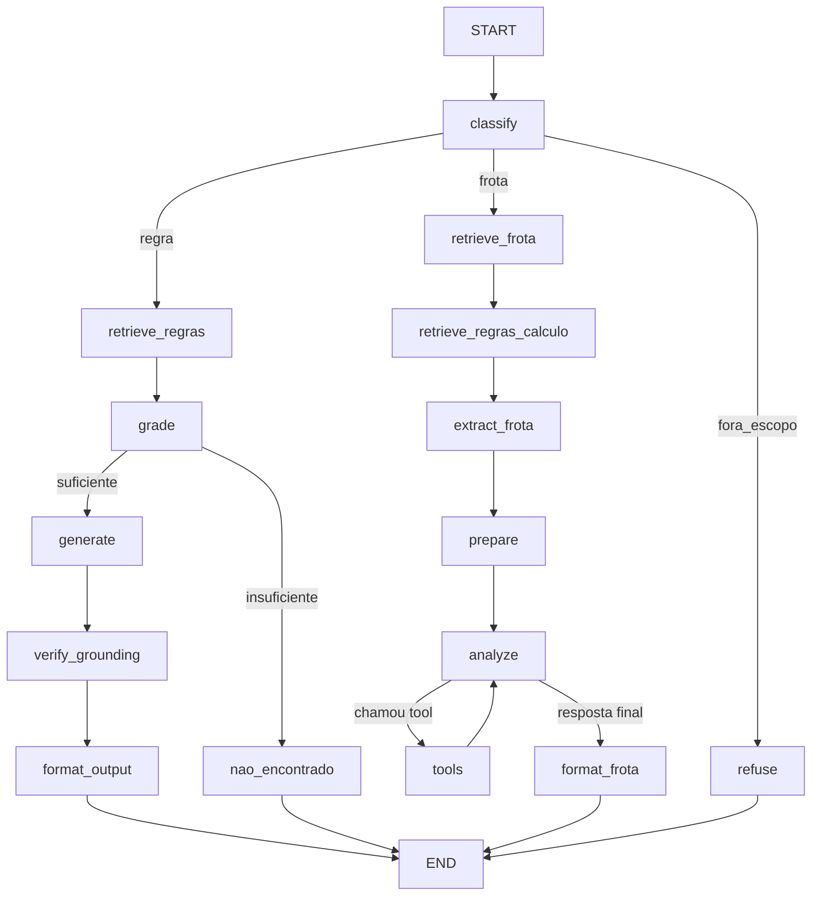

# Semana 3 — RAG: perguntas ao manual e ao relatório da frota

## 1. O que é a atividade e por que ela existe

Um agente despachante controla uma frota de navios e, a cada tick, precisa tomar decisões: quem acelera, quem reduz, quem chega primeiro. As **regras do jogo** (limite de tempestade, reserva de combustível, prazos, preços) estão espalhadas em vários documentos.

A tentação é colocar **todos os documentos dentro do prompt**. Isso funciona para um texto curto, mas **não escala**: fica caro, lento, e o modelo se perde no meio de tanta informação.

A solução é o **RAG**:

```
pergunta → BUSCAR só os trechos relevantes → GERAR a resposta com base neles → resposta + fontes
```

As duas etapas pesadas (dividir o texto e calcular os vetores) acontecem **uma vez**, na indexação. A cada pergunta, só se calcula o embedding da pergunta e se compara com os vetores prontos.

| Conceito | O que é |
|---|---|
| **Chunk** | Trecho do documento. Aqui: **uma seção inteira** (título `##` + conteúdo), não um corte de 500 caracteres |
| **Embedding** | O texto transformado em um vetor de números; textos com sentido parecido ficam próximos |
| **Vector store** | Banco que guarda os vetores e encontra os mais próximos do vetor da pergunta |
| **Metadados** | `doc` (qual arquivo) e `secao` (qual seção) — permitem **citar a fonte** e **filtrar a busca** |
| **Fonte** | Lista das seções recuperadas, montada **pelo código** (nunca pelo modelo, que pode errar ao citar) |

### Os dois exercícios

| | Exercício 1 (introdutório) | Exercício 2 (completo) |
|---|---|---|
| **O que** | Agente que responde perguntas **só do manual**, citando fontes | Agente que **roteia** a pergunta, busca em 2 documentos, **calcula com tools** e é **avaliado** |
| **Grafo** | 3 nós lineares, sem condicional | 15 nós + 2 arestas condicionais + ciclo de ferramentas |
| **Documentos** | `manual_operacoes.txt` | `manual_operacoes.txt` + `relatorio_frota.txt` |
| **Novidade** | Indexação, chunks, prompt que obriga a usar só o contexto | Classificação de intenção, filtro por metadado, saída estruturada, `grade`, reducer, avaliação |
| **Arquivo** | `src/graph/builder_exercise1.py` | `src/graph/builder.py` (o padrão) |

---

## 2. Os dados (em `dados/`)

| Arquivo | Conteúdo | Papel |
|---|---|---|
| `manual_operacoes.txt` | **11 seções** (`##`): Tempestade, Combustível e reserva, Abastecimento, Avaria de motor, Descarga e prazos, etc. | Fonte das **regras** |
| `relatorio_frota.txt` | **5 seções**: os 4 navios (S1-FAROL a S4-ATLAS) com distância, velocidade, combustível, reserva e tempestade | Fonte dos **dados** (simula a telemetria) |
| `avaliacao.json` | 9 perguntas com os termos esperados | Gabarito do `scripts/avaliar.py` |

> Documentos **fictícios e didáticos**, derivados do desafio "Orquestrando o Oceano".

**Onde os números moram** (essa é a ideia central do exercício 2):

- **Relatório** → quanto cada navio tem de combustível, distância, velocidade, se há tempestade.
- **Manual** → o limite de **12 nós** em tempestade, a reserva de 15%, a fórmula do ETA.
- **Tools (código)** → a conta em si (divisão, `min()`, comparação).
- **LLM** → a ponte: lê o 12 no manual e **passa à ferramenta** como argumento.

Nada disso está digitado no código. Se o manual mudar o limite, o comportamento muda sem alterar uma linha de Python.

---

## 3. Estrutura do projeto

```
Semana-3-Bootcamp-main/
├── .env                      chaves e configuração (não versione)
├── .venv/                    ambiente virtual (Python 3.14)
├── requirements.txt          dependências
├── README.md                 este arquivo
├── dados/
│   ├── manual_operacoes.txt      11 seções de regras
│   ├── relatorio_frota.txt       5 seções com os 4 navios
│   └── avaliacao.json/txt           9 perguntas de gabarito
├── scripts/
│   ├── explorar_chunks.py        imprime cada chunk + metadados (exercício 1)
│   ├── avaliar.py                roda as 9 perguntas e reporta a taxa (exercício 2)
│   └── teste_mcp.py              smoke test do servidor MCP (lista tools e chama 2)
├── mcp_server/                   ⭐ EXTRA: servidor MCP "porto-alfa"
│   └── server.py                 5 tools MCP (RAG + cálculos), stdio ou HTTP
└── src/
    ├── app/
    │   ├── main.py               CLI do exercício 2 (roda o grafo completo)
    │   └── mcp_main.py           ⭐ EXTRA: CLI do agente híbrido (RAG + MCP)
    ├── utils/
    │   ├── llm_adapter.py         ÚNICO lugar que cria o LLM e os embeddings
    │   ├── vector_store.py        indexação, busca filtrada e formatação de fonte
    │   ├── mcp_client.py          sessão MCP persistente + conversão em tools
    │   └── langfuse_client.py     run_config()/flush() — funciona com ou sem Langfuse
    └── graph/
        ├── state.py               estado compartilhado (TypedDict + reducers)
        ├── builder2.py            ⭐ grafo do exercício 2 (15 nós + condicionais)
        ├── builder1.py            grafo do exercício 1 (3 nós lineares)
        ├── builder_hibrido.py     ⭐ EXTRA: grafo híbrido (RAG local + tools MCP)
        ├── routing.py             route_by_intent e route_after_grade
        ├── tools.py               calcular_eta_horas, velocidade_efetiva, reserva_ok
        ├── prompts/               RAG_PROMPT, CLASSIFY_PROMPT, GRADE_PROMPT, EXTRACT_PROMPT,
        │                          ANALYZE_PROMPT, GROUNDING_PROMPT, MCP_ANALYZE_PROMPT
        └── nodes/                 17 nós (ver seção 5)
```

---

## 4. Como configurar

### 4.1 Dependências

```bash
# na raiz do projeto
python -m venv .venv
.venv\Scripts\activate          # Windows
pip install -r requirements.txt
```

Principais pacotes: `langgraph` (grafo), `langchain` (prompts/chains), `langchain-groq` (LLM),
`langchain-huggingface` + `sentence-transformers` (embeddings locais), `langchain-text-splitters`
(divisão por seção), `langfuse` (observabilidade, opcional).

### 4.2 Variáveis de ambiente (`.env`)

```ini
LLM_PROVIDER=groq                        # provedor do modelo de chat
LLM_MODEL=openai/gpt-oss-120b            # modelo de chat
GROQ_API_KEY=gsk_...                     # chave do Groq

EMBEDDINGS_PROVIDER=huggingface          # embeddings LOCAIS, sem chave
EMBEDDINGS_MODEL=sentence-transformers/paraphrase-multilingual-MiniLM-L12-v2

LANGFUSE_PUBLIC_KEY=                     # opcional — traces
LANGFUSE_SECRET_KEY=
LANGFUSE_BASE_URL=

MAX_TOKENS=1024                          # G9: teto de tokens por resposta (teto duro 4096)
EGRESS_STRICT=1                          # G9: 0 desliga o bloqueio de egress
```

**Decisões de configuração (e por quê):**

| Decisão | Motivo |
|---|---|
| LLM no **Groq** | você já tinha conta e chave; é rápido e tem tier grátis |
| Embeddings **HuggingFace local** | o **Groq não tem endpoint de embeddings** e não havia chave OpenAI na máquina. Local = grátis, sem chave, sem limite de requisições. Modelo **multilíngue** porque o manual é em português |
| `temperature=0` | respostas mais estáveis, o que ajuda a comparar execuções |
| Langfuse **opcional** | o projeto roda igual sem as chaves; quando existirem, os traces aparecem sozinhos |

### 4.3 Segurança do ambiente (G9)

| Mecanismo | Onde | O que faz |
|---|---|---|
| `.env` fora do repositório | `.gitignore` | a chave nunca versiona |
| Varredura de segredos | `.github/workflows/ci.yml` (`gitleaks`) | a CI falha se uma chave for commitada e confere que `.env` não está rastreado |
| Testes sem rede | `tests/conftest.py` | fixture `autouse` instala a guarda de socket: conexão externa = erro, não depende de chave nem de internet |
| Egress restrito | `src/utils/egress.py` | allowlist = host do modelo + dos embeddings + Langfuse (subdomínios aceitos), validada **pelo nome** no `getaddrinfo` e no `connect` — o IP só passa se veio de resolução de host permitido. As apps instalam a guarda na partida; `EGRESS_STRICT=0` desliga e provedor desconhecido não instala (allowlist incompleta não derruba o app) |
| Teto de custo | `src/utils/llm_adapter.py`, `recursion_limit=25` | `max_tokens` por resposta (`MAX_TOKENS`, teto duro 4096) e limite de laço no grafo |

---

## 5. O que cada peça faz

### 5.1 `src/utils/llm_adapter.py` — o adaptador

```python
get_llm()        # cria o chat model (lê LLM_PROVIDER/LLM_MODEL do .env)
get_embeddings() # cria o modelo de embeddings (lê EMBEDDINGS_*/EMBEDDINGS_MODEL)
```

**Por que existe:** nenhum outro arquivo pode importar o provedor diretamente. Para trocar de
Groq para OpenAI, muda-se **só o `.env`** — zero alteração de código. É a mesma ideia do exercício 1 da semana 1.

### 5.2 `src/utils/vector_store.py` — o coração do RAG

| Função | O que faz |
|---|---|
| `carregar_chunks(arquivo)` | Lê o `.txt` e divide **por seção** com `MarkdownHeaderTextSplitter(headers_to_split_on=[("##", "secao")])`. Guarda `doc` (nome do arquivo) e `secao` em cada chunk. `strip_headers=False` mantém o título **dentro** do texto — sem isso o chunk "Tempestade" perderia o contexto na busca |
| `get_vector_store(arquivos)` | Indexa (chunk → embedding → vetor) **uma única vez** e reaproveita, via `lru_cache`. Em produção isso roda offline, antes da aplicação atender usuários |
| `buscar(pergunta, doc, k)` | Busca por similaridade **filtrando por metadado** `doc`. É o que faz a pergunta sobre a frota não trazer chunks do manual (e vice-versa) |
| `fonte(d)` | Formata `manual_operacoes#Tempestade` — a string que aparece em "Fontes:" |

### 5.3 `src/graph/state.py` — o estado

```python
class State(TypedDict, total=False):
    pergunta: str
    intent: str
    contextos: list[Document]
    suficiente: bool
    resposta: str
    frota: list[dict]
    contexto_regras: str
    messages: Annotated[list, add_messages]
    fontes: Annotated[list[str], operator.add]   # ← REDUCER
    afirmacoes_sem_base: list[str]               # ← extra: detector de alucinação
    resultado: str
    bloqueio: str                                # ← G1/G5: código do bloqueio
    alertas: Annotated[list[str], operator.add]  # ← G8: REDUCER de alertas
```

- `total=False` → o estado começa só com `pergunta` e cada nó preenche o que sabe.
- `Annotated[list, add_messages]` → mensagens são **acrescentadas**, não substituídas — é o que permite o ciclo `analyze ⇄ tools`.
- **`operator.add` em `fontes`** → **reducer**: quando `retrieve_frota` e `retrieve_regras_calculo` devolvem fontes, as listas são **somadas**. Sem ele, a segunda busca apagaria a primeira.
- **`bloqueio` e `alertas` precisam estar declarados aqui**: o LangGraph só persiste chaves do schema. Sem `bloqueio`, `route_after_guard` nunca vê o bloqueio e o grafo segue fluxo em vez de parar em `blocked`; sem `alertas` com reducer, o alerta de um nó apaga o do anterior (G8).

### 5.4 `src/graph/prompts/` — os 7 prompts

| Prompt | Usado por | Papel |
|---|---|---|
| `RAG_PROMPT` | `generate` | Responder **só** com o contexto; se não estiver lá, responder exatamente *"Não encontrado no manual de operações."* |
| `CLASSIFY_PROMPT` | `classify` | Classificar a pergunta em `regra`, `frota` ou `fora_escopo` |
| `GRADE_PROMPT` | `grade` | Dizer se o contexto recuperado **basta** para responder (`suficiente: bool`) |
| `EXTRACT_PROMPT` | `extract_frota` | Transformar o texto do relatório em lista estruturada de navios — **copiar, não inventar** |
| `ANALYZE_PROMPT` | `prepare` | Instruir o despachante a usar as ferramentas para **qualquer** verificação/cálculo e a passar o limite de tempestade **lido no manual** |
| `GROUNDING_PROMPT` | `verify_grounding` | ⭐ Extra: separar a resposta em afirmações e dizer quais **não têm base** no contexto recuperado |
| `MCP_ANALYZE_PROMPT` | `prepare_hibrido` | ⭐ Extra: instruir o agente híbrido a consultar tudo pelas tools MCP |

Os prompts ficam em `prompts/`, **não dentro dos nós** — separa "o que se pede" de "o que se executa".

### 5.5 `src/graph/tools.py` — o código que calcula

| Ferramenta | Entrada → Saída |
|---|---|
| `calcular_eta_horas` | `distancia_nm / velocidade_kn` → ETA em horas (arredondado em 2 casas) |
| `velocidade_efetiva` | `min(velocidade_kn, limite_tempestade_kn)` se em tempestade |
| `reserva_ok` | `combustivel_t >= reserva_t` → `True` se pode zarpar |

**A mudança crucial em relação à semana 1:** `limite_tempestade_kn` virou **argumento**. Antes o `12.0` estava escrito dentro da ferramenta; agora o modelo precisa **ler o 12 no manual recuperado** e passá-lo. A docstring é o que o modelo lê para decidir quando usar cada ferramenta; os tipos viram o schema dos argumentos.

### 5.6 `src/graph/nodes/` — o que cada arquivo faz

São **17 nós** (arquivos `.py`), mais o `__init__.py` (só marca o pacote, vazio).
Todos seguem o mesmo contrato: **recebem o `state` e devolvem um `dict` com as chaves que querem atualizar** — o LangGraph faz o merge no estado.

#### Roteamento e respostas fixas

| Arquivo | Tipo | O que faz | O que devolve |
|---|---|---|---|
| `classify.py` | LLM + saída estruturada | Lê a pergunta e decide o caminho. A classe `Intencao` usa `Literal["regra", "frota", "fora_escopo"]` — o Pydantic **rejeita** qualquer outro valor, então o roteamento nunca recebe lixo | `{"intent": "regra"}` |
| `refuse.py` | código (puro) | Resposta padrão para pergunta fora do tema | `{"resultado": "Pergunta fora do escopo..."}` |
| `nao_encontrado.py` | código (puro) | Resposta padrão quando o contexto não basta (caminho `grade → insuficiente`) | `{"resultado": "Não encontrado no manual de operações."}` |

#### Busca (RAG)

| Arquivo | Tipo | O que faz | O que devolve |
|---|---|---|---|
| `retrieve_regras.py` | busca filtrada | Busca **top 3** chunks só do `manual_operacoes` para a pergunta | `{"contextos": [...], "fontes": [...]}` |
| `retrieve_frota.py` | busca filtrada | Busca **k=10** (quase todos) do `relatorio_frota` — pergunta comparativa precisa de **todos** os navios | `{"contextos": [...], "fontes": [...]}` |
| `retrieve_regras_calculo.py` | busca filtrada | Consulta **fixa** (`CONSTANTE`, não a pergunta): tempestade, reserva e fórmula do ETA — as regras que o `analyze` sempre precisa | `{"contexto_regras": "texto concatenado", "fontes": [...]}` |
| `retrieve.py` | busca (exercício 1) | Único nó do grafo linear: top 3 do manual, **sem** passar por `buscar()` — usa `get_vector_store(("manual_operacoes.txt",))` direto | `{"contextos": [...]}` |

#### Validação do contexto (caminho `regra`)

| Arquivo | Tipo | O que faz | O que devolve |
|---|---|---|---|
| `grade.py` | LLM + saída estruturada | Pergunta ao LLM: "esse contexto basta para responder?". `Relevancia.suficiente: bool` | `{"suficiente": true}` |
| `generate.py` | LLM | Concatena os chunks em `contexto` e responde com `RAG_PROMPT` — **só** com o que está lá; fora disso, "Não encontrado" | `{"resposta": "..."}` |
| `verify_grounding.py` | LLM + saída estruturada | ⭐ Extra anti-alucinação: divide a resposta em `Afirmacao(texto, suportada)` e compara cada uma com o contexto. Pula o teste se a resposta já é "Não encontrado" | `{"afirmacoes_sem_base": ["...", "..."]}` |

#### Montagem e execução do caminho `frota`

| Arquivo | Tipo | O que faz | O que devolve |
|---|---|---|---|
| `extract_frota.py` | LLM + saída estruturada | Texto bruto do relatório → lista tipada `NavioRelatorio` (7 campos). **Cópia, não invenção** — o schema força o modelo a preencher o que existe | `{"frota": [{id, destino, distancia_nm, ...}]}` |
| `prepare.py` | código (puro) | Monta as mensagens iniciais do despachante: `ANALYZE_PROMPT` com regras + frota (em `json.dumps`) + pergunta | `{"messages": [...]}` |
| `analyze.py` | LLM + `bind_tools` | O "cérebro" do caminho frota: enxerga as **tools locais** (`TOOLS` de `tools.py`), decide qual chamar; quando para de chamar, escreve a recomendação final | `{"messages": [AIMessage]}` |
| `tools`* | `ToolNode` | **Executa** as ferramentas pedidas pelo `analyze` e devolve o resultado como mensagem `tool` — fecha o ciclo `analyze → tools → analyze` | `{"messages": [ToolMessage]}` |

\* `tools` não é arquivo: é o `ToolNode` (gerado pelo LangGraph) montado no `builder.py`.

#### Extras (⭐ híbrido MCP e detector de alucinação)

| Arquivo | Tipo | O que faz | O que devolve |
|---|---|---|---|
| `prepare_hibrido.py` | código (puro) | Igual ao `prepare`, mas só com a pergunta — as regras/frota chegam **pelas tools MCP**, não pelo prompt | `{"messages": [...]}` |
| `analyze_hibrido.py` | **fábrica** de nó | `make_analyze(tools)` devolve a função `analyze` com as tools **MCP** amarradas — assim o builder decide quais tools o modelo enxerga (MCP, locais ou ambas) | `{"messages": [AIMessage]}` |
| `format_frota.py` | código (puro) | Monta a saída final do caminho frota. No modo MCP as fontes vêm **dentro** do conteúdo das `tool messages` (marcadores `[doc#secao]`) — ele extrai por regex e **deduplica** | `{"resultado": "resposta\nFontes: ..."}` |

#### Formatação da saída (caminho `regra`)

| Arquivo | Tipo | O que faz | O que devolve |
|---|---|---|---|
| `format_output.py` | código (puro) | Junta `Pergunta / Resposta / Fontes` (fonte vem do estado ou do metadata dos chunks). Se `afirmacoes_sem_base` não está vazio, **acrescenta o aviso** `⚠️ Sem base no contexto: ...` | `{"resultado": "..."}` |

### 5.7 `src/graph/routing.py` — os roteadores

```python
route_by_intent(state)    # devolve state["intent"]  → "regra" | "frota" | "fora_escopo"
route_after_grade(state)  # devolve "suficiente" ou "insuficiente"
```

**Por que são código e não LLM:** `classify` usa o LLM para *entender* a pergunta; já traduzir isso
para o próximo nó é decisão determinística e previsível — não deve custar uma chamada nem variar.

### 5.8 `src/graph/builder.py` — a fiação



- `add_conditional_edges` com `route_by_intent` → 3 caminhos.
- `tools_condition` (pronto do LangGraph) → devolve `"tools"` se o modelo pediu ferramenta, senão `END`.
- O ciclo `analyze → tools → analyze` repete até o modelo entregar a resposta final.
- Os 4 nós terminais vão direto para `END`.

O exercício 1 (`builder_exercise1.py`) é só `START → retrieve → generate → format_output → END`,
**sem nenhuma aresta condicional**.

### 5.9 `src/utils/langfuse_client.py` — observabilidade

- `run_config()` devolve a config com o handler do Langfuse **se as chaves existirem**, ou `{}` caso contrário → o projeto roda com ou sem Langfuse.
- Cada aplicação nomeia seus traces (`porto-alfa-rag` ou `porto-alfa-hibrido`) e adiciona tags para filtrar por fluxo.
- `LANGFUSE_TIMEOUT=30` amplia para 30 segundos o timeout de envio dos traces ao Langfuse.
- `flush()` roda em `finally`, garantindo o envio dos traces em scripts curtos mesmo quando uma execução falha.
- O callback LangChain mantém as etapas, gerações e uso de tokens; a saída raiz contém só a resposta final e o campo de raciocínio do provedor não é registrado.
- Perguntas, prompts e contexto recuperado ainda podem aparecer nas observações de etapas; não envie dados sensíveis se não quiser armazená-los no Langfuse.
- O SDK do Langfuse é importado sob demanda, então o projeto continua funcionando sem as chaves configuradas.

### 5.10 `scripts/` — inspeção e avaliação

| Script | O que faz |
|---|---|
| `explorar_chunks.py` | Imprime cada chunk com metadados. **Esperado: 11 chunks** no manual. Rode **antes** de ligar o LLM: é assim que você confere se a divisão está certa |
| `avaliar.py` | Percorre `avaliacao.json`, roda o grafo para cada pergunta, confere se a resposta **contém** os termos esperados e imprime a taxa de acerto |

---

## 6. Como rodar

Sempre **na raiz do projeto**, com o `.venv` ativo.

### Exercício 1 — grafo linear de 3 nós

```bash
python -c "from src.graph.builder_exercise1 import build_graph; print(build_graph().invoke({'pergunta':'Qual a velocidade segura em tempestade na rota direta?'})['resultado'])"
```

Saída esperada:

```text
Pergunta: Qual a velocidade segura em tempestade na rota direta?
Resposta: A velocidade segura em tempestade na rota direta é de 12 nós.
Fontes: manual_operacoes#Tempestade, manual_operacoes#...
```

Teste também **"Qual a cor do casco do S2-MARE?"** → deve devolver
`Não encontrado no manual de operações.` (o modelo não inventa).

### Explorar os chunks (sem LLM)

```bash
python -m scripts.explorar_chunks
```

### Exercício 2 — grafo completo (interativo)

```bash
python -m src.app.main
```

Digite a pergunta. Exemplos:

| Pergunta | Caminho | Saída esperada |
|---|---|---|
| `Qual a velocidade segura em tempestade na rota direta?` | `regra` | 12 nós |
| `Qual navio chega primeiro ao porto?` | `frota` | **S3-CORAL**, 56,67 h; S1-FAROL bloqueado |
| `Algum navio está impedido de zarpar?` | `frota` | **S1-FAROL** (30 t < reserva de 33 t) |
| `Qual a velocidade máxima permitida em nevoeiro?` | `regra` | Não encontrado no manual de operações. |
| `Qual a capital do Brasil?` | `fora_escopo` | Pergunta fora do escopo... |

### Avaliação (9 perguntas)

```bash
python -m scripts.avaliar
```

Saída:

```text
q1 OK  q2 OK  q3 OK  q4 OK  q5 OK  q6 OK  q7 OK  q8 OK  q9 OK
Acertos: 9/9
```

### Trace local (sem Langfuse)

```bash
python -c "from src.graph.builder import build_graph; [print(p) for p in build_graph().stream({'pergunta':'Qual navio chega primeiro ao porto?'}, stream_mode='updates')]"
```

Cada item mostra **o nó que rodou e o que ele devolveu** — é um trace local, simples e suficiente para enxergar o caminho completo.

### Com Langfuse

Preencha `LANGFUSE_PUBLIC_KEY`, `LANGFUSE_SECRET_KEY` e `LANGFUSE_BASE_URL` no `.env`.
Pronto: `run_config()` passa a incluir o handler sozinho e os traces aparecem no painel,
com o nome de execução e as tags (`avaliacao`, `semana-3`) definidos no `avaliar.py`.

---

## 7. Resultado e verificação

**Avaliação: 9/9 acertos** (executado em 2026-11-18, Python 3.14, Groq + embeddings locais).

Checklist do enunciado:

- [x] As três intenções seguem caminhos diferentes
- [x] Pergunta sem resposta no manual termina em "Não encontrado" (não inventa)
- [x] Dados dos navios vêm **do relatório**, limite de tempestade **do manual** — nada digitado no código
- [x] O modelo chamou as tools; S1-FAROL excluído; S3-CORAL venceu
- [x] O trace mostra todos os nós do caminho
- [x] `avaliar.py` roda as 9 perguntas e reporta a taxa
- [x] Documento dividido **por seção**, com `doc` e `secao` nos metadados (11 chunks)
- [x] Indexação acontece **uma vez** (`lru_cache`), não a cada pergunta
- [x] Grafo do exercício 1 tem 3 nós e nenhuma aresta condicional

### Correções feitas durante a implementação

| Problema | Solução |
|---|---|
| Groq **não oferece** endpoint de embeddings | Troca para HuggingFace **local** (`langchain-huggingface`), multilíngue |
| Chave do Groq do Bootcamp04 estava **revogada** (erro 401) | Uso da chave já existente em outros projetos da máquina |
| A resposta da q3 era `15 %` com **espaço não separável** (U+202F) e o teste falhava | Normalização de espaços em `avaliar.py` — o agente acertava, só a comparação falhava |
| No exercício 1 a busca puxava chunks do relatório | `retrieve` passou a usar `get_vector_store(("manual_operacoes.txt",))` |

---

## 8. Para pensar (reflexões do enunciado)

1. **`k=1` vs `k=10`:** com `k=1` a resposta pode depender de um chunk errado; com `k=10` entra ruído e sobra contexto. O ideal depende da pergunta — e por isso existe o `grade`.
2. **Chunk por seção vs. corte de 500 caracteres:** a seção é uma unidade de significado. Um corte automático pode separar "12 nós" da frase que explica a que se refere.
3. **Manual mudou e o índice não foi refeito:** o agente responde com a versão antiga, **sem avisar**. Em produção, o índice é reconstruído em CI/CD junto com o documento.
4. **`retrieve_frota` com `k=3`:** se um navio ficasse de fora, "quem chega primeiro" seria respondido com dados incompletos — e possivelmente errado. Por isso o caminho agregativo traz **tudo** (`k=10` + filtro).
5. **`grade` por LLM vs. limiar de pontuação:** o LLM entende nuance mas custa uma chamada e erra; o limiar é barato e determinístico mas depende da qualidade dos embeddings.
6. **Limite de tempestade na ferramenta:** se ficasse escrito dentro dela, uma mudança no manual exigiria mudar código. Passando como argumento, o comportamento acompanha o documento — a contrapartida é que, se a busca falhar, a ferramenta recebe valor errado. Por isso em produção **valida-se em código**.

---

## 9. Desafios extras (opcional)

- **Scores da busca:** `similarity_search_with_score` e imprimir a pontuação de cada chunk.
- **Comparar `k`:** rodar a mesma pergunta com `k=1`, `k=3` e `k=6` e comparar.
- **Validação determinística:** recalculuar os ETAs em Python depois do `analyze` e comparar com a recomendação.
- **Limite de passos** no ciclo `analyze ⇄ tools` para evitar laço infinito.
- **Interface Streamlit** em `src/app` com campo de pergunta e exibição das fontes.
- **Registro no Langfuse:** gravar a nota do `avaliar.py` como *score* do trace.

---

## 10. Extras: detector de alucinação e agente MCP híbrido

Além dos dois exercícios obrigatórios, o projeto ganhou duas extensões ("brincar com RAG e MCP").

### 10.1 Detector de alucinação (groundedness)

**O problema:** o RAG reduz a alucinação, mas não elimina — o modelo pode responder com dados
fora do contexto recuperado (o "12 nós" certo ao lado de um "20 nós" inventado).

**A solução:** um nó extra `verify_grounding` (`src/graph/nodes/verify_grounding.py`), inserido
entre `generate` e `format_output`:

1. Recebe a **resposta** e o **contexto recuperado**;
2. Um LLM com saída estruturada (`GROUNDING_PROMPT`) divide a resposta em afirmações
   (`Afirmacao`) e classifica cada uma como `com_base: bool`;
3. As afirmações sem base vão para `afirmacoes_sem_base` no estado;
4. `format_output` acrescenta o aviso `⚠️ Sem base no contexto: ...` na saída.

Detalhes de projeto:

- **Pula o caminho "Não encontrado"** — não há resposta para verificar;
- **Só o contexto recuperado vale como base** (não o conhecimento prévio do modelo);
- O verificador roda **depois** do generate, no mesmo turno — custa 1 chamada extra por pergunta.

Teste da prova (resposta falsa injetada de propósito):

```bash
python -c "
from src.graph.nodes.verify_grounding import verify_grounding
from src.utils.vector_store import buscar
estado = {'contextos': buscar('velocidade segura tempestade', 'manual_operacoes', k=3),
          'resposta': 'Na rota direta a velocidade segura e de 20 nos, e o casco do S2-MARE e pintado de azul.'}
print(verify_grounding(estado)['afirmacoes_sem_base'])"
```

Saída esperada: **as duas** afirmações inventadas listadas.

### 10.2 Agente MCP híbrido (RAG + MCP)

**O que é:** o mesmo problema de despacho, mas com a arquitetura trocada — o RAG vira
**ferramenta MCP** e um servidor MCP expõe dados e cálculos para **qualquer** cliente.

```
mcp_server/server.py  ──stdio/HTTP──►  src/utils/mcp_client.py (sessão persistente)
        │                                        │
        │  5 tools:                              ▼
        │  consultar_manual (RAG)        src/graph/builder_hibrido.py
        │  consultar_frota (RAG)         classify → regra: RAG local (barato)
        │  calcular_eta_horas                   → frota: modelo decide qual tool MCP chamar
        │  velocidade_efetiva                   → fora_escopo: refuse
        │  reserva_ok
```

| Peça | Papel |
|---|---|
| `mcp_server/server.py` | `FastMCP("porto-alfa")` com 5 tools. Rodo **só Python puro** nas tools de cálculo (servidor MCP não deve depender do LangChain do cliente). Reaproveita `src/utils/vector_store.py` e `src/graph/tools.py` |
| `src/utils/mcp_client.py` | Sessão MCP **persistente** (`sessao_mcp()`), convertida em tools do LangChain (`ferramentas_mcp()`) |
| `src/graph/builder_hibrido.py` | Grafo: caminho `regra` mantém o RAG local **barato**; caminho `frota` dá as tools MCP ao modelo (`analyze ⇄ tools`) |
| `src/app/mcp_main.py` | CLI interativo do agente híbrido |
| `scripts/teste_mcp.py` | Smoke test: lista as tools, chama `consultar_manual` duas vezes e `calcular_eta_horas` |

**Por que híbrido e não tudo via MCP:** busca no manual é a mesma coisa de sempre — não faz
sentido pagar o custo de uma chamada de rede/protocolo por ela. O RAG local fica no caminho de
perguntas de regra; MCP entra onde o modelo precisa **decidir dinamicamente** o que consultar
(comparações de frota, cálculos encadeados).

**Decisão importante — sessão persistente:** a primeira versão usou
`MultiServerMCPClient.get_tools()`, que abre uma **nova sessão (novo processo) a cada chamada de
tool** — e cada processo gastava ~14 s carregando o modelo de embeddings. Com sessão persistente
o servidor sobe uma vez e as chamadas ficam em **~0,1 s**. O servidor também **aquece** o vector
store na inicialização (`_aquecer()`), porque carregar extensões pesadas no meio do event loop
travava neste ambiente (Windows + venv no OneDrive).

### 10.3 Como rodar os extras

```bash
# smoke test do servidor MCP (lista tools + 2 chamadas)
python -m scripts.teste_mcp

# agente híbrido (interativo; o cliente sobe o servidor sozinho via stdio)
python -m src.app.mcp_main

# servidor MCP "cru", para testar com outro cliente (ex.: Claude Desktop)
python -m mcp_server.server          # stdio
python -m mcp_server.server --http   # streamable HTTP em 127.0.0.1:8765
```

Para usar um servidor externo, defina no `.env`: `MCP_TRANSPORT=http` e `MCP_URL=http://127.0.0.1:8765/mcp`.

Exemplo de pergunta para o híbrido: **"Qual navio chega primeiro ao porto?"** → o classificador
manda para `frota`, o modelo chama `consultar_frota`, `consultar_manual`, `reserva_ok`,
`velocidade_efetiva` e `calcular_eta_horas`, e responde com a tabela de ETAs + S1-FAROL
bloqueado (30 t < 33 t).

---

## 11. Ponte para o desafio final

Todas as peças já existem:

- **RAG** informa regras e procedimentos → semana 3.
- **Tools** fazem o cálculo → semanas 1 e 3.
- **Servidor MCP** com dados externos → semana 2.
- **Segurança e observabilidade completas** → semana 4.

O que falta é uma troca de papel: no desafio final a **telemetria não passa por RAG** — ela chega
**estruturada, a cada tick**. O RAG continua útil para o que é texto e muda pouco:
**regras, manuais e procedimentos**.

---

## 12. Colocar esta pasta no GitHub (passo a passo)

> **Situação de partida:** esta pasta **ainda não é um repositório git** (não existe `.git`).
> O Git já está instalado (`git --version` → `2.56.0`) e o `gh` CLI **não** está — por isso o
> repositório é criado pela **web** do GitHub. Tudo é feito no terminal do VS Code.

### 12.1 Abrir o terminal na pasta certa

1. Abra a pasta `Semana-3-Bootcamp-main` no VS Code.
2. Abra o terminal integrado: **Ctrl + `** (tecla de acento, ao lado do 1) ou
   **Terminal → New Terminal**.
3. Confirme que você está na raiz do projeto:

```powershell
pwd
# C:\Users\pedro\OneDrive\Desktop\Semana-3-Bootcamp-main
```

> Todos os comandos abaixo assumem esse diretório. Se o `pwd` mostrar outra coisa:
> `cd "C:\Users\pedro\OneDrive\Desktop\Semana-3-Bootcamp-main"`.

### 12.2 Revisar o `.gitignore` (o que **não** vai para o GitHub)

O `.gitignore` da raiz já está pronto e lista o que o Git ignora. Abra-o e confira que contém,
no mínimo:

```gitignore
.env          # chaves de API — NUNCA sobe
.venv/        # 54 mil arquivos de dependência
__pycache__/
.pytest_cache/
.coverage
```

**Por que importa:** o `.env` tem a `GROQ_API_KEY`. Se ele entrar no repositório, a chave vira
pública (ou vaza para quem tem acesso) e você precisa **rotacionar a chave**. O `.venv` só
poluiria o histórico com dezenas de milhares de arquivos.

### 12.3 Criar o repositório local

```powershell
git init -b main
```

Saída esperada: `Initialized empty Git repository in .../.git/`

### 12.4 Escolher o que entra no commit

```powershell
git add -A
git status
```

O `git status` lista dois blocos: **staged** (verdes, `A`) e **untracked** (`??`). Confira que:

- ✅ aparecem: `src/`, `tests/`, `scripts/`, `mcp_server/`, `dados/`, `README.md`,
  `requirements.txt`, `.github/`, `.gitignore`, os `.py` e os exercícios;
- ❌ **NÃO** aparecem: `.env`, `.venv`, `__pycache__`, `.pytest_cache`, `.coverage`.

Conferência rápida (deve voltar **vazio**):

```powershell
git status --porcelain | Select-String -Pattern "^A\s+\.(env|venv)|__pycache__"
# sem saída = nada sensível nem lixo de ambiente entrou
```

Se algo indesejado aparecer, desfaça com `git rm --cached <arquivo>` e ajuste o `.gitignore`.

### 12.5 Dizer quem é você (uma vez só)

```powershell
git config user.name  "seu-nome"
git config user.email "seu-email@exemplo.com"
```

Use **o mesmo e-mail da conta do GitHub** — é ele que liga o commit ao seu perfil.

### 12.6 Commit inicial

```powershell
git commit -m "Estado inicial: grafo RAG com guardrails G1-G9"
```

Verifique o histórico:

```powershell
git log --oneline
# <hash> Estado inicial: grafo RAG com guardrails G1-G9
```

### 12.7 Criar o repositório no GitHub (pela web)

1. Acesse **github.com** e faça login.
2. Vá em **New repository** (`github.com/new`).
3. Preencha:
   - **Repository name:** `Semana-3-Bootcamp-main` (ou o nome que preferir);
   - **Private** (recomendado — o projeto é de estudo) ou **Public**;
4. **Não marque** "Add a README file", "Add .gitignore" nem "Choose a license":
   o repositório precisa nascer **vazio**, senão o primeiro push é rejeitado
   (histórios divergentes).
5. Clique em **Create repository** e **não feche a página** — o GitHub mostra os comandos
   de conexão.

### 12.8 Conectar a pasta ao repositório e enviar

Na página do repositório vazio, copie o endereço HTTPS
(`https://github.com/SEU_USUARIO/NOME_DO_REPO.git`) e rode no terminal:

```powershell
git remote add origin https://github.com/SEU_USUARIO/NOME_DO_REPO.git
git branch -M main
git push -u origin main
```

Substitua `SEU_USUARIO` e `NOME_DO_REPO` pelos seus.

- **Primeira vez:** o Git Credential Manager do Windows abre uma janela no navegador para
  você autorizar. Faça login no GitHub e clique em **Authorize**. A senha da conta **não** é
  usada — se pedir senha, crie um **Personal Access Token** em
  github.com/settings/tokens e use-o no lugar da senha.
- `git push -u origin main` liga o ramo local ao remoto **uma única vez**; depois, só
  `git push`.

Sucesso: recarregue a página do GitHub e você verá todos os arquivos.

### 12.9 Fluxo de todo dia (modificações → GitHub)

```powershell
# 1. ver o que mudou
git status
git diff                     # alterações em arquivos já rastreados

# 2. rodar a suíte antes de commitar (sem rede, com o venv)
.\.venv\Scripts\python.exe -m pytest tests -q

# 3. colocar as mudanças na área de commit
git add -A                   # ou: git add src\guardrails\saida.py

# 4. conferir que nada sensível entrou
git status --porcelain | Select-String "\.env$"

# 5. commitar com mensagem que explica o porquê
git commit -m "G7: corrige ETA numérico com vencedor correto"

# 6. enviar para o GitHub
git push
```

**No VS Code:** a aba **Source Control** (ícone do canto esquerdo, ou **Ctrl+Shift+G**)
lista as mudanças. Clique no `+` ao lado de cada arquivo (Stage), escreva a mensagem em
**Message** e no ✓ (Commit). Depois use o botão ⬇ (Sync/Publish) para fazer o push.

### 12.10 Comandos de resgate

```powershell
git status                        # em que estado estou?
git log --oneline --graph         # histórico
git restore <arquivo>             # desfazer alteração LOCAL de um arquivo
git restore --staged <arquivo>    # tirar da área de commit (continua salvo)
git show --stat                   # o que entrou no último commit
git remote -v                     # endereço do repositório no GitHub
git remote remove origin          # desconectar (para ligar a outro repo)
```

### 12.11 Erros comuns

| Sintoma | Causa e solução |
|---|---|
| `fatal: not a git repository` | você está fora da pasta ou esqueceu o `git init` (passo 12.3) |
| `Please tell me who you are` | falta o `git config user.name/user.email` (passo 12.5) |
| `remote contains work that you do not have` / `Updates were rejected` | o repositório no GitHub não está vazio — ou ele foi criado com README, ou você está mandando para o repo errado. Confira com `git remote -v` |
| `Authentication failed` | o Credential Manager não abriu: gere um **Personal Access Token** em github.com/settings/tokens e use-o como senha |
| Commit por engano com `.env` | **não faça push ainda**: `git rm --cached .env && git commit -m "Remove .env"`; se já enviou, **rotate a chave** |
| Quer começar do zero | apague a pasta `.git` (`Remove-Item -Recurse -Force .git`) e refaça da 12.3 em diante (o código não é afetado) |

### 12.12 Verificação final

- [ ] `git log --oneline` mostra ao menos um commit.
- [ ] `git status` diz `nothing to commit, working tree clean`.
- [ ] A página do GitHub mostra os arquivos e **não** contém `.env` nem `.venv`.
- [ ] A suíte passa: `.\.venv\Scripts\python.exe -m pytest tests -q` → **90 passed**.
- [ ] Cada alteração nova vira um commit com mensagem clara e é enviada com `git push`.

