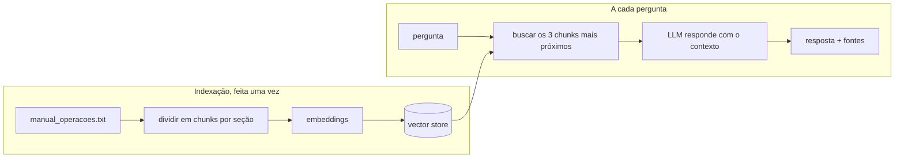

# Semana 3, exercício 1 (introdutório): perguntas ao manual de operações

**Quando:** meio da semana (segunda e terça). **Tema:** RAG, parte 1. **Dados:** [`dados/manual_operacoes.txt`](dados/manual_operacoes.txt). **Pré-requisito:** semana 1.

## O desafio, em poucas palavras

No desafio final, as regras do jogo estão espalhadas em vários documentos: tempestade, combustível, reparo, preços, prazos. Um agente precisa **consultar** essas regras na hora de decidir, citando de onde tirou cada informação.

Colocar **todos** os documentos dentro do prompt funciona para um texto curto, mas não escala: fica caro, lento e o modelo se perde no meio de tanta informação. A solução é o **RAG** (Retrieval-Augmented Generation): **buscar** só os trechos relevantes e **gerar** a resposta com base neles.

Neste exercício a empresa "entregou" a você um **manual de operações** (um arquivo `.txt`). Você vai construir um agente que responde perguntas **somente com base nesse manual**, dizendo as fontes. Ainda não há dados da frota nem telemetria: isso vem no exercício 2.

## O que você vai aprender

- As etapas do RAG: **carregar → dividir (chunks) → embeddings → vector store → buscar → responder**.
- Dividir o documento **por seção** e guardar metadados (documento e seção).
- Escrever um prompt que **obriga** o modelo a usar só o contexto.
- Montar o RAG como um **grafo linear** de 3 nós.
- Mostrar as **fontes** da resposta.

## Como o RAG funciona



Um **embedding** transforma um texto em um vetor de números. Textos com sentido parecido têm vetores próximos. O **vector store** guarda os vetores dos chunks e encontra os mais próximos do vetor da pergunta.

## O documento

O manual tem seções como "Tempestade", "Combustível e reserva", "Abastecimento", "Avaria de motor e reparo" e "Descarga e prazos". Cada seção começa com `## `. Abra o arquivo e leia antes de começar. É um documento **fictício**, baseado no desafio.

## Passo a passo

1. **Projeto:** copie o projeto da semana 1. Mantenha `src/utils` e `src/app`. Reescreva `src/graph`. Copie `dados/manual_operacoes.txt`. Instale `pip install langchain-text-splitters`.
2. **Embeddings:** em `llm_adapter.py`, crie `get_embeddings()` (provedor e modelo vêm do `.env`).
3. **Vector store:** crie `src/utils/vector_store.py` (acréscimo à estrutura) com:
   - uma função que lê o arquivo e **divide por seção**, guardando `doc` (nome do arquivo) e `secao` nos metadados;
   - `get_vector_store()`, que indexa uma vez e reaproveita.
4. **Explorar os chunks:** antes de ligar o LLM, escreva `scripts/explorar_chunks.py` para imprimir cada chunk com seus metadados. Confira: **quantos chunks** saíram? A seção "Tempestade" ficou inteira em um chunk?
5. **Estado:** `pergunta`, `contextos`, `resposta`, `resultado`.
6. **Prompt** (`prompts/rag_prompt.py`): responda **somente** com o contexto; se não estiver lá, diga exatamente "Não encontrado no manual de operações."
7. **Nós:** `retrieve` (busca os 3 chunks), `generate` (LLM com o contexto) e `format_output` (resposta + lista de fontes).
8. **Builder** e **`main.py`**: `START → retrieve → generate → format_output → END`.

## Resultado esperado

| Pergunta | Resposta esperada | Seção de origem |
|---|---|---|
| Qual a velocidade segura em tempestade na rota direta? | 12 nós | Tempestade |
| E na rota protegida? | 15 nós | Tempestade |
| Qual a reserva mínima de combustível? | 15% da capacidade do tanque | Combustível e reserva |
| Qual o lote mínimo de compra de combustível? | 5 t (múltiplos de 5 t) | Abastecimento |
| Quanto custa e quanto dura o reparo do motor? | D$ 24.000 e 12 ticks | Avaria de motor e reparo |
| Qual o prazo de entrega do S3-CORAL? | tick 378 | Descarga e prazos |
| Qual a cor do casco do S2-MARE? | "Não encontrado no manual de operações." | (nenhuma) |

Saída esperada (formato):

```text
Pergunta: Qual a velocidade segura em tempestade na rota direta?
Resposta: Na rota direta, a velocidade segura em tempestade é de 12 nós.
Fontes: manual_operacoes#Tempestade, manual_operacoes#Velocidade, manual_operacoes#Procedimentos de segurança
```

As fontes vêm da **busca** (código), não do que o modelo escreve. Por isso podem incluir seções que não foram decisivas.

## Como verificar

- [ ] O documento é dividido **por seção**, com `doc` e `secao` nos metadados.
- [ ] A indexação acontece uma vez, não a cada pergunta.
- [ ] Seis perguntas respondidas corretamente.
- [ ] A pergunta sem resposta no manual devolve "Não encontrado..." (o modelo não inventa).
- [ ] As fontes aparecem na saída.
- [ ] O grafo tem 3 nós e nenhuma aresta condicional.

## Para pensar

1. O que muda se o `k` (quantidade de chunks) for 1? E 10?
2. Por que dividir por seção é melhor aqui do que cortar o texto a cada 500 caracteres?
3. O que acontece quando o manual muda de versão e o índice não é refeito?
4. Uma pergunta como "qual navio é mais rápido?" precisa de **várias** seções. O que a busca com `k=3` pode deixar de fora?

## Desafio extra (opcional)

- Use `similarity_search_with_score` e mostre a pontuação de cada chunk.
- Rode a mesma pergunta com `k=1`, `k=3` e `k=6` e compare a qualidade das respostas.
- Crie uma interface em `src/app` (por exemplo, Streamlit) onde o usuário envia um `.txt` e faz perguntas sobre ele.

---

# Como resolver (gabarito do instrutor)

## Ideia geral

O RAG troca "colocar tudo no prompt" por "buscar o que importa". As duas etapas pesadas (dividir e calcular embeddings) acontecem **uma vez**. A cada pergunta, só se calcula o embedding da pergunta e se compara com os vetores prontos.

## `src/utils/llm_adapter.py` (acréscimo)

```python
from langchain.embeddings import init_embeddings


def get_embeddings():
    return init_embeddings(
        model=os.environ["EMBEDDINGS_MODEL"],
        provider=os.environ["EMBEDDINGS_PROVIDER"],
    )
```

## `src/utils/vector_store.py`

```python
from functools import lru_cache
from pathlib import Path

from langchain_core.documents import Document
from langchain_core.vectorstores import InMemoryVectorStore
from langchain_text_splitters import MarkdownHeaderTextSplitter

from src.utils.llm_adapter import get_embeddings

DADOS = Path(__file__).resolve().parents[2] / "dados"


def carregar_chunks(arquivo: Path) -> list[Document]:
    texto = arquivo.read_text(encoding="utf-8")
    divisor = MarkdownHeaderTextSplitter(
        headers_to_split_on=[("##", "secao")], strip_headers=False
    )
    chunks = divisor.split_text(texto)
    for chunk in chunks:
        chunk.metadata["doc"] = arquivo.stem
    return chunks


@lru_cache
def get_vector_store(
    arquivos: tuple[str, ...] = ("manual_operacoes.txt",),
) -> InMemoryVectorStore:
    store = InMemoryVectorStore(get_embeddings())
    for nome in arquivos:
        store.add_documents(carregar_chunks(DADOS / nome))
    return store
```

Pontos para comentar:

- `MarkdownHeaderTextSplitter` divide por `## `. O arquivo é `.txt`, mas usa a mesma marcação.
- `strip_headers=False` mantém o título da seção **dentro** do texto do chunk. Sem isso, o título ("Tempestade") iria só para o metadado e o chunk perderia contexto na busca.
- `doc` e `secao` nos metadados permitem **citar a fonte** e **filtrar** (vai ser útil no exercício 2).
- `lru_cache` garante que o índice é criado uma única vez no processo. Em um sistema real, o índice é construído **offline**, antes de a aplicação atender usuários.
- `InMemoryVectorStore` é suficiente para o curso. Em produção, usa-se um banco vetorial.

## `scripts/explorar_chunks.py`

```python
from src.utils.vector_store import DADOS, carregar_chunks

for chunk in carregar_chunks(DADOS / "manual_operacoes.txt"):
    print(chunk.metadata)
    print(chunk.page_content[:120].replace("\n", " "), "...\n")
```

O manual tem **11 seções**, então a saída deve mostrar 11 chunks. Rode com `python -m scripts.explorar_chunks`.

## `src/graph/state.py`

```python
from typing import TypedDict

from langchain_core.documents import Document


class State(TypedDict, total=False):
    pergunta: str
    contextos: list[Document]
    resposta: str
    resultado: str
```

## `src/graph/prompts/rag_prompt.py`

```python
from langchain_core.prompts import ChatPromptTemplate

RAG_PROMPT = ChatPromptTemplate.from_messages(
    [
        (
            "system",
            "Você responde perguntas sobre o manual de operações do porto. "
            "Use SOMENTE o contexto fornecido. Se a resposta não estiver no contexto, "
            "responda exatamente: Não encontrado no manual de operações.",
        ),
        ("human", "Contexto:\n{contexto}\n\nPergunta: {pergunta}"),
    ]
)
```

## Nós

`src/graph/nodes/retrieve.py`:

```python
from src.graph.state import State
from src.utils.vector_store import get_vector_store


def retrieve(state: State) -> dict:
    docs = get_vector_store().similarity_search(state["pergunta"], k=3)
    return {"contextos": docs}
```

`src/graph/nodes/generate.py`:

```python
from src.graph.prompts.rag_prompt import RAG_PROMPT
from src.graph.state import State
from src.utils.llm_adapter import get_llm


def generate(state: State) -> dict:
    contexto = "\n\n".join(doc.page_content for doc in state["contextos"])
    resposta = (RAG_PROMPT | get_llm()).invoke(
        {"contexto": contexto, "pergunta": state["pergunta"]}
    )
    return {"resposta": str(resposta.content)}
```

`src/graph/nodes/format_output.py`:

```python
from src.graph.state import State


def format_output(state: State) -> dict:
    fontes = ", ".join(
        f"{d.metadata['doc']}#{d.metadata.get('secao', '-')}" for d in state["contextos"]
    )
    return {
        "resultado": f"Pergunta: {state['pergunta']}\nResposta: {state['resposta']}\nFontes: {fontes}"
    }
```

## `src/graph/builder.py`

```python
from langgraph.graph import END, START, StateGraph

from src.graph.nodes.format_output import format_output
from src.graph.nodes.generate import generate
from src.graph.nodes.retrieve import retrieve
from src.graph.state import State


def build_graph():
    graph = StateGraph(State)
    graph.add_node("retrieve", retrieve)
    graph.add_node("generate", generate)
    graph.add_node("format_output", format_output)

    graph.add_edge(START, "retrieve")
    graph.add_edge("retrieve", "generate")
    graph.add_edge("generate", "format_output")
    graph.add_edge("format_output", END)
    return graph.compile()
```

## `src/app/main.py`

```python
from src.graph.builder import build_graph
from src.utils.langfuse_client import flush, run_config


def main() -> None:
    graph = build_graph()
    pergunta = input("Pergunta: ").strip()
    print(graph.invoke({"pergunta": pergunta}, config=run_config())["resultado"])
    flush()


if __name__ == "__main__":
    main()
```

## O que comentar com a turma

- **Por que RAG, se o manual cabe no prompt?** Aqui cabe, mas com dezenas de documentos não. Mostre o custo: contexto menor, resposta mais barata e mais focada.
- **Chunk por seção.** Cada seção é uma unidade de significado. Cortes por tamanho fixo podem separar "12 nós" da frase que explica a que se refere.
- **Fonte vem do código.** O modelo pode errar ao citar; a lista de seções recuperadas é fato. Isso importa em auditoria.
- **"Não encontrado" é uma resposta válida.** Um agente que inventa é pior do que um que admite não saber. O prompt exige a frase exata para facilitar testes.
- **Limite do RAG.** O RAG **informa**; não **garante**. Regras críticas (como o limite de tempestade) continuam validadas em código, como nas semanas 1 e 2.
- **Ponte para o exercício 2.** E se a pergunta for "qual navio chega primeiro?" Os dados dos navios também virão de um documento, e a resposta exige **calcular**.
