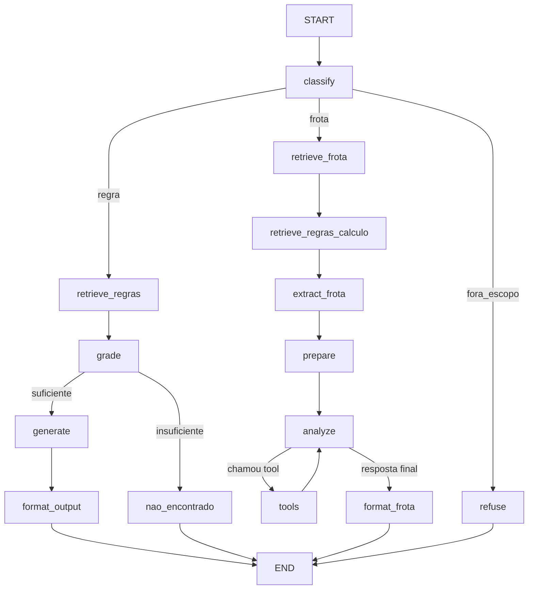
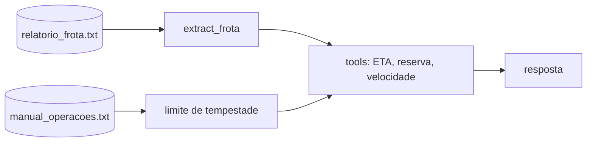

# Semana 3, exercício 2 (completo): RAG com dados da frota, tools e Langfuse

**Quando:** fim da semana (quarta a sexta). **Tema:** RAG, parte 2 (e traces com Langfuse). **Dados:** [`dados/manual_operacoes.txt`](dados/manual_operacoes.txt), [`dados/relatorio_frota.txt`](dados/relatorio_frota.txt) e [`dados/avaliacao.json`](dados/avaliacao.json). **Pré-requisito:** exercício 1 da semana 3 e exercício 2 da semana 1.

## O desafio, em poucas palavras

No desafio final, o agente recebe **telemetria** dos navios em tempo real. Ainda não chegamos lá. Neste exercício vamos simular a entrada dos dados com **um documento**: um `relatorio_frota.txt` com a situação de cada navio, "mandado" ao agente como se fosse a telemetria. As **regras** continuam no `manual_operacoes.txt`.

Agora a pergunta "qual navio chega primeiro ao porto?" (a mesma da semana 1) exige **três coisas juntas**:

1. **buscar** a situação dos navios no relatório;
2. **buscar** as regras no manual (limite de tempestade, reserva de combustível);
3. **calcular** com ferramentas (ETA), usando os dados e as regras recuperados.

E o agente precisa saber **quando não sabe**: se a pergunta não está no manual, a resposta correta é "não encontrado". Por fim, você vai **observar** tudo com o **Langfuse**.

## O que você vai aprender

- **Rotear** a pergunta: dúvida de regra, pergunta sobre a frota ou fora do escopo.
- **Avaliar a relevância** do que foi recuperado e dizer "não encontrado" quando não houver base.
- **Filtrar a busca por metadado** (documento) e entender quando o `k` precisa cobrir tudo.
- **Extrair dados estruturados** de texto recuperado.
- Alimentar **tools** com dados e regras vindos do RAG.
- Usar um **reducer** no estado para acumular fontes.
- Ler **traces** no Langfuse e rodar uma **avaliação** com perguntas de gabarito.

## O grafo que você vai construir



| Nó | Tipo | O que faz |
|---|---|---|
| `classify` | LLM (saída estruturada) | `regra`, `frota` ou `fora_escopo` |
| `retrieve_regras` | busca | top 3 chunks do **manual** para a pergunta |
| `grade` | LLM (saída estruturada) | o contexto basta para responder? (`suficiente`) |
| `generate` | LLM | responde só com o contexto (igual ao exercício 1) |
| `nao_encontrado` | código | "Não encontrado no manual de operações." |
| `retrieve_frota` | busca com filtro | **todos** os chunks do **relatório** da frota |
| `retrieve_regras_calculo` | busca | chunks do manual sobre tempestade, reserva e ETA |
| `extract_frota` | LLM (saída estruturada) | transforma o texto do relatório em uma lista de navios |
| `prepare`, `analyze`, `tools` | como na semana 1 | análise com tool calling |
| `format_output`, `format_frota` | código | texto final com as fontes |
| `refuse` | código | "Pergunta fora do escopo..." |

## As regras do problema

As mesmas das semanas anteriores, mas **agora você não digita os números**: eles vêm dos documentos.

| Regra (no manual) | Efeito |
|---|---|
| ETA = distância / velocidade | tempo de viagem em horas |
| Tempestade: limite de 12 nós (rota direta) | velocidade efetiva = `min(velocidade, 12)` |
| Combustível abaixo da reserva | navio não pode zarpar |

Dados (no relatório da frota):

| Navio | Distância (nm) | Velocidade (nós) | Tempestade | Combustível (t) | Reserva (t) |
|---|---:|---:|:---:|---:|---:|
| S1-FAROL | 700 | 14 | não | 30 | 33 |
| S2-MARE | 760 | 16 | sim | 100 | 42 |
| S3-CORAL | 680 | 12 | não | 115 | 51 |
| S4-ATLAS | 820 | 14 | sim | 145 | 60 |

Resposta esperada para "qual navio chega primeiro": **S3-CORAL** (56,67 h). S1-FAROL está bloqueado por combustível; S2-MARE (63,33 h) e S4-ATLAS (68,33 h) são limitados a 12 nós.

## Passo a passo

### Parte A: roteamento e "não encontrado" (caminho `regra`)

1. Copie o projeto do exercício 1 da semana 3 e os dois `.txt` e o `avaliacao.json` para `dados/`.
2. Em `vector_store.py`, indexe **os dois documentos** e crie `buscar(pergunta, doc, k)`, que filtra por `metadata["doc"]`.
3. Crie `classify` (prompt com as três intenções) e `route_by_intent`.
4. Crie `grade` (saída estruturada `suficiente: bool`) e `route_after_grade`.
5. Ligue: `retrieve_regras → grade → generate → format_output` ou `nao_encontrado`.
6. Teste "Qual a velocidade segura em tempestade?" e "Qual a velocidade máxima permitida em nevoeiro?" (o manual não fala de nevoeiro).

### Parte B: dados da frota vindos do documento (caminho `frota`)

1. Acrescente ao `State` os campos novos. **Atenção:** `fontes` usa um **reducer** (`operator.add`) para que vários nós possam acrescentar fontes.
2. `retrieve_frota`: filtro `doc == "relatorio_frota"` e `k` grande o bastante para trazer **todas** as seções. Por quê? Uma pergunta que compara navios precisa de **todos** os navios.
3. `retrieve_regras_calculo`: busca no manual com uma consulta fixa ("velocidade em tempestade, reserva de combustível e cálculo do ETA").
4. `extract_frota`: o LLM transforma o texto do relatório em uma lista estruturada (`Navio`). A instrução: copiar os valores, não inventar.
5. Reaproveite da semana 1 `prepare`, `analyze`, `tools` e as ferramentas. Mude **uma** coisa: `velocidade_efetiva` agora recebe o `limite_tempestade_kn` como argumento. O modelo precisa **ler o 12 no manual** (contexto) e passá-lo à ferramenta.
6. Crie `format_frota` (resposta + fontes).
7. Teste: "Qual navio chega primeiro ao porto?" e "Algum navio está impedido de zarpar? Qual e por quê?".

### Parte C: observar e avaliar

1. Configure o Langfuse no `.env` (`LANGFUSE_PUBLIC_KEY`, `LANGFUSE_SECRET_KEY`, `LANGFUSE_BASE_URL`). O `run_config()` que você já tem passa o handler.
2. Rode a pergunta de chegada e abra o trace. Responda:
   - Qual nó levou mais tempo?
   - Quantas chamadas ao LLM a pergunta fez e quantos tokens gastou?
   - Quais chunks foram recuperados pelo `retrieve_regras_calculo`?
3. Crie `scripts/avaliar.py`: percorre `dados/avaliacao.json`, roda o grafo para cada pergunta e confere se o resultado contém os termos esperados. Imprima a taxa de acerto.
4. Compare os tokens do caminho `regra` com os do caminho `frota`.

Sem Langfuse? Use `graph.stream(entrada, stream_mode="updates")` e imprima o que cada nó devolve: é um trace local, simples.

## Resultado esperado

| Pergunta | Caminho | Resposta esperada |
|---|---|---|
| Qual a velocidade segura em tempestade na rota direta? | regra | 12 nós |
| Qual a reserva mínima de combustível? | regra | 15% da capacidade do tanque |
| Qual navio chega primeiro ao porto? | frota | **S3-CORAL**, ETA de 56,67 h; S1-FAROL bloqueado |
| Algum navio está impedido de zarpar? | frota | **S1-FAROL** (30 t abaixo da reserva de 33 t) |
| Qual a velocidade máxima permitida em nevoeiro? | regra | "Não encontrado no manual de operações." |
| Qual a capital do Brasil? | fora_escopo | "Pergunta fora do escopo..." |

Saída esperada do `avaliar.py` (os números podem variar um pouco entre execuções):

```text
q1 OK  q2 OK  q3 OK  q4 OK  q5 OK  q6 OK  q7 OK  q8 OK  q9 OK
Acertos: 9/9
```

## Como verificar

- [ ] As três intenções seguem caminhos diferentes.
- [ ] Uma pergunta sem resposta no manual termina em "Não encontrado" (não inventa).
- [ ] Os dados dos navios chegam **do relatório**, e o limite de tempestade **do manual**. Nada digitado no código.
- [ ] O modelo chamou as tools; o S1-FAROL foi excluído; S3-CORAL venceu.
- [ ] O trace (Langfuse ou `stream`) mostra todos os nós do caminho.
- [ ] `avaliar.py` roda as 9 perguntas e reporta a taxa de acerto.
- [ ] Você comparou o custo em tokens entre os caminhos `regra` e `frota`.

## Para pensar

1. Por que `retrieve_frota` não usa só `k=3`? O que aconteceria com a resposta "quem chega primeiro" se um navio ficasse de fora?
2. O que é melhor para o `grade`: um LLM ou um limiar de pontuação da busca? Que vantagens e riscos cada um tem?
3. Por que o limite de tempestade passa pela ferramenta e não fica escrito dentro dela? E o que acontece se o manual mudar o limite?
4. No desafio final, a telemetria **não** vai por RAG: chega estruturada a cada tick. Em que casos o RAG continua útil (regras, procedimentos) e em quais não deve ser usado?
5. Qual caminho gasta mais tokens? Em um orçamento de tokens, como você decidiria quando acionar cada um?

## Desafio extra (opcional)

- Substitua o `grade` por um **limiar de pontuação** (`similarity_search_with_score`) e compare com o grader por LLM.
- Valide em código o resultado do `analyze`: recalcule os ETAs em Python e compare com a resposta.
- Faça o `avaliar.py` registrar a nota como *score* no Langfuse.
- Crie uma interface em `src/app` (Streamlit) com um campo de pergunta e a exibição das fontes.

---

# Como resolver (gabarito do instrutor)

## Ideia geral

Este grafo junta tudo que a turma viu até aqui: **roteamento condicional**, **RAG com filtro**, **saída estruturada**, **tool calling** e **observabilidade**. A novidade é o fluxo de dados:



Os números vêm dos documentos; o **cálculo** vem das ferramentas; o LLM faz a **ponte** entre os dois.

## `src/utils/vector_store.py` (evolução)

```python
from functools import lru_cache
from pathlib import Path

from langchain_core.documents import Document
from langchain_core.vectorstores import InMemoryVectorStore
from langchain_text_splitters import MarkdownHeaderTextSplitter

from src.utils.llm_adapter import get_embeddings

DADOS = Path(__file__).resolve().parents[2] / "dados"
ARQUIVOS = ("manual_operacoes.txt", "relatorio_frota.txt")


def carregar_chunks(arquivo: Path) -> list[Document]:
    texto = arquivo.read_text(encoding="utf-8")
    divisor = MarkdownHeaderTextSplitter(
        headers_to_split_on=[("##", "secao")], strip_headers=False
    )
    chunks = divisor.split_text(texto)
    for chunk in chunks:
        chunk.metadata["doc"] = arquivo.stem
    return chunks


@lru_cache
def get_vector_store(arquivos: tuple[str, ...] = ARQUIVOS) -> InMemoryVectorStore:
    store = InMemoryVectorStore(get_embeddings())
    for nome in arquivos:
        store.add_documents(carregar_chunks(DADOS / nome))
    return store


def buscar(pergunta: str, doc: str, k: int) -> list[Document]:
    return get_vector_store().similarity_search(
        pergunta, k=k, filter=lambda d: d.metadata.get("doc") == doc
    )


def fonte(d: Document) -> str:
    return f"{d.metadata['doc']}#{d.metadata.get('secao', '-')}"
```

`filter` recebe uma função que decide, por documento, se ele entra na busca. É o **filtro por metadado**: a pergunta sobre a frota não deve trazer chunks do manual, e vice-versa.

## `src/graph/state.py`

```python
import operator
from typing import Annotated, TypedDict

from langchain_core.documents import Document
from langgraph.graph.message import add_messages


class State(TypedDict, total=False):
    pergunta: str
    intent: str
    contextos: list[Document]
    suficiente: bool
    resposta: str
    frota: list[dict]
    contexto_regras: str
    messages: Annotated[list, add_messages]
    fontes: Annotated[list[str], operator.add]
    resultado: str
```

`Annotated[list[str], operator.add]` é um **reducer**: quando dois nós devolvem `fontes`, as listas são **somadas**, em vez de a segunda apagar a primeira.

## Prompts

`src/graph/prompts/classify_prompt.py`:

```python
from langchain_core.prompts import ChatPromptTemplate

CLASSIFY_PROMPT = ChatPromptTemplate.from_messages(
    [
        (
            "system",
            "Classifique a pergunta de um operador de porto:\n"
            "- regra: dúvida sobre regras, limites, valores e procedimentos do manual\n"
            "- frota: pergunta sobre a situação atual dos navios (quem chega primeiro, "
            "ETA, quem está impedido de zarpar)\n"
            "- fora_escopo: qualquer outro assunto",
        ),
        ("human", "{pergunta}"),
    ]
)
```

`src/graph/prompts/grade_prompt.py`:

```python
from langchain_core.prompts import ChatPromptTemplate

GRADE_PROMPT = ChatPromptTemplate.from_messages(
    [
        (
            "system",
            "Diga se o contexto contém a informação necessária para responder à pergunta. "
            "Responda suficiente=true somente se a resposta estiver explícita no contexto.",
        ),
        ("human", "Contexto:\n{contexto}\n\nPergunta: {pergunta}"),
    ]
)
```

`rag_prompt.py` é o do exercício 1. `src/graph/prompts/extract_prompt.py`:

```python
from langchain_core.prompts import ChatPromptTemplate

EXTRACT_PROMPT = ChatPromptTemplate.from_messages(
    [
        (
            "system",
            "Extraia os navios do relatório abaixo. Copie os valores exatamente como estão "
            "no texto e não invente nenhum dado. Ignore a seção 'Sobre este documento'.",
        ),
        ("human", "{relatorio}"),
    ]
)
```

`src/graph/prompts/analyze_prompt.py`:

```python
from langchain_core.prompts import ChatPromptTemplate

ANALYZE_PROMPT = ChatPromptTemplate.from_messages(
    [
        (
            "system",
            "Você é um despachante de porto. Regras do manual (trechos recuperados):\n{regras}\n\n"
            "Use as ferramentas para QUALQUER verificação ou cálculo: reserva_ok (reserva de "
            "combustível), velocidade_efetiva (passe o limite de tempestade que está no manual) "
            "e calcular_eta_horas. Nunca calcule de cabeça. Responda à pergunta do operador, "
            "liste o ETA dos navios elegíveis e os navios bloqueados com o motivo.",
        ),
        ("human", "Navios (extraídos do relatório):\n{frota}\n\nPergunta: {pergunta}"),
    ]
)
```

## `src/graph/tools.py` (única mudança)

```python
from langchain_core.tools import tool


@tool
def calcular_eta_horas(distancia_nm: float, velocidade_kn: float) -> float:
    """Calcula o ETA em horas: distancia_nm dividida por velocidade_kn."""
    return round(distancia_nm / velocidade_kn, 2)


@tool
def velocidade_efetiva(
    velocidade_kn: float, em_tempestade: bool, limite_tempestade_kn: float
) -> float:
    """Velocidade efetiva. Em tempestade, é no máximo o limite de tempestade do manual."""
    return min(velocidade_kn, limite_tempestade_kn) if em_tempestade else velocidade_kn


@tool
def reserva_ok(combustivel_t: float, reserva_t: float) -> bool:
    """True se o combustível a bordo cobre a reserva mínima (navio pode zarpar)."""
    return combustivel_t >= reserva_t


TOOLS = [calcular_eta_horas, velocidade_efetiva, reserva_ok]
```

## Nós

`src/graph/nodes/classify.py`:

```python
from typing import Literal

from pydantic import BaseModel

from src.graph.prompts.classify_prompt import CLASSIFY_PROMPT
from src.graph.state import State
from src.utils.llm_adapter import get_llm


class Intencao(BaseModel):
    intent: Literal["regra", "frota", "fora_escopo"]


def classify(state: State) -> dict:
    chain = CLASSIFY_PROMPT | get_llm().with_structured_output(Intencao)
    return {"intent": chain.invoke({"pergunta": state["pergunta"]}).intent}
```

`src/graph/nodes/retrieve_regras.py`:

```python
from src.graph.state import State
from src.utils.vector_store import buscar, fonte


def retrieve_regras(state: State) -> dict:
    docs = buscar(state["pergunta"], "manual_operacoes", k=3)
    return {"contextos": docs, "fontes": [fonte(d) for d in docs]}
```

`src/graph/nodes/grade.py`:

```python
from pydantic import BaseModel

from src.graph.prompts.grade_prompt import GRADE_PROMPT
from src.graph.state import State
from src.utils.llm_adapter import get_llm


class Relevancia(BaseModel):
    suficiente: bool


def grade(state: State) -> dict:
    contexto = "\n\n".join(d.page_content for d in state["contextos"])
    chain = GRADE_PROMPT | get_llm().with_structured_output(Relevancia)
    r = chain.invoke({"contexto": contexto, "pergunta": state["pergunta"]})
    return {"suficiente": r.suficiente}
```

`generate.py` e `format_output.py` vêm do exercício 1. O `format_output` usa as fontes acumuladas:

```python
from src.graph.state import State


def format_output(state: State) -> dict:
    fontes = ", ".join(state.get("fontes", []))
    return {
        "resultado": f"Pergunta: {state['pergunta']}\nResposta: {state['resposta']}\nFontes: {fontes}"
    }
```

`src/graph/nodes/nao_encontrado.py` e `refuse.py`:

```python
from src.graph.state import State


def nao_encontrado(state: State) -> dict:
    return {"resultado": "Não encontrado no manual de operações."}
```

```python
from src.graph.state import State


def refuse(state: State) -> dict:
    return {"resultado": "Pergunta fora do escopo (navios, portos e regras de operação)."}
```

`src/graph/nodes/retrieve_frota.py`:

```python
from src.graph.state import State
from src.utils.vector_store import buscar, fonte


def retrieve_frota(state: State) -> dict:
    # k alto de propósito: a pergunta compara todos os navios, então todas as seções entram
    docs = buscar(state["pergunta"], "relatorio_frota", k=10)
    return {"contextos": docs, "fontes": [fonte(d) for d in docs]}
```

`src/graph/nodes/retrieve_regras_calculo.py`:

```python
from src.graph.state import State
from src.utils.vector_store import buscar, fonte

CONSULTA = "velocidade em tempestade, reserva de combustível e cálculo do ETA"


def retrieve_regras_calculo(state: State) -> dict:
    docs = buscar(CONSULTA, "manual_operacoes", k=4)
    return {
        "contexto_regras": "\n\n".join(d.page_content for d in docs),
        "fontes": [fonte(d) for d in docs],
    }
```

`src/graph/nodes/extract_frota.py`:

```python
from pydantic import BaseModel

from src.graph.prompts.extract_prompt import EXTRACT_PROMPT
from src.graph.state import State
from src.utils.llm_adapter import get_llm


class NavioRelatorio(BaseModel):
    id: str
    destino: str
    distancia_nm: float
    velocidade_kn: float
    combustivel_t: float
    reserva_t: float
    em_tempestade: bool


class Frota(BaseModel):
    navios: list[NavioRelatorio]


def extract_frota(state: State) -> dict:
    relatorio = "\n\n".join(d.page_content for d in state["contextos"])
    chain = EXTRACT_PROMPT | get_llm().with_structured_output(Frota)
    frota = chain.invoke({"relatorio": relatorio})
    return {"frota": [n.model_dump() for n in frota.navios]}
```

`src/graph/nodes/prepare.py` e `analyze.py`:

```python
import json

from src.graph.prompts.analyze_prompt import ANALYZE_PROMPT
from src.graph.state import State


def prepare(state: State) -> dict:
    mensagens = ANALYZE_PROMPT.format_messages(
        regras=state["contexto_regras"],
        frota=json.dumps(state["frota"], ensure_ascii=False),
        pergunta=state["pergunta"],
    )
    return {"messages": mensagens}
```

```python
from src.graph.state import State
from src.graph.tools import TOOLS
from src.utils.llm_adapter import get_llm


def analyze(state: State) -> dict:
    llm = get_llm().bind_tools(TOOLS)
    return {"messages": [llm.invoke(state["messages"])]}
```

`src/graph/nodes/format_frota.py`:

```python
from src.graph.state import State


def format_frota(state: State) -> dict:
    fontes = ", ".join(dict.fromkeys(state.get("fontes", [])))
    return {"resultado": f"{state['messages'][-1].content}\nFontes: {fontes}"}
```

`dict.fromkeys` remove fontes repetidas mantendo a ordem.

## `src/graph/routing.py`

```python
from src.graph.state import State


def route_by_intent(state: State) -> str:
    return state["intent"]


def route_after_grade(state: State) -> str:
    return "suficiente" if state["suficiente"] else "insuficiente"
```

## `src/graph/builder.py`

```python
from langgraph.graph import END, START, StateGraph
from langgraph.prebuilt import ToolNode, tools_condition

from src.graph.nodes.analyze import analyze
from src.graph.nodes.classify import classify
from src.graph.nodes.extract_frota import extract_frota
from src.graph.nodes.format_frota import format_frota
from src.graph.nodes.format_output import format_output
from src.graph.nodes.generate import generate
from src.graph.nodes.grade import grade
from src.graph.nodes.nao_encontrado import nao_encontrado
from src.graph.nodes.prepare import prepare
from src.graph.nodes.refuse import refuse
from src.graph.nodes.retrieve_frota import retrieve_frota
from src.graph.nodes.retrieve_regras import retrieve_regras
from src.graph.nodes.retrieve_regras_calculo import retrieve_regras_calculo
from src.graph.routing import route_after_grade, route_by_intent
from src.graph.state import State
from src.graph.tools import TOOLS


def build_graph():
    graph = StateGraph(State)
    for nome, funcao in {
        "classify": classify,
        "retrieve_regras": retrieve_regras,
        "grade": grade,
        "generate": generate,
        "format_output": format_output,
        "nao_encontrado": nao_encontrado,
        "retrieve_frota": retrieve_frota,
        "retrieve_regras_calculo": retrieve_regras_calculo,
        "extract_frota": extract_frota,
        "prepare": prepare,
        "analyze": analyze,
        "format_frota": format_frota,
        "refuse": refuse,
    }.items():
        graph.add_node(nome, funcao)
    graph.add_node("tools", ToolNode(TOOLS))

    graph.add_edge(START, "classify")
    graph.add_conditional_edges(
        "classify",
        route_by_intent,
        {"regra": "retrieve_regras", "frota": "retrieve_frota", "fora_escopo": "refuse"},
    )
    graph.add_edge("retrieve_regras", "grade")
    graph.add_conditional_edges(
        "grade", route_after_grade, {"suficiente": "generate", "insuficiente": "nao_encontrado"}
    )
    graph.add_edge("generate", "format_output")
    graph.add_edge("retrieve_frota", "retrieve_regras_calculo")
    graph.add_edge("retrieve_regras_calculo", "extract_frota")
    graph.add_edge("extract_frota", "prepare")
    graph.add_edge("prepare", "analyze")
    graph.add_conditional_edges(
        "analyze", tools_condition, {"tools": "tools", END: "format_frota"}
    )
    graph.add_edge("tools", "analyze")
    for terminal in ("format_output", "nao_encontrado", "format_frota", "refuse"):
        graph.add_edge(terminal, END)
    return graph.compile()
```

## `scripts/avaliar.py`

```python
import json

from src.graph.builder import build_graph
from src.utils.langfuse_client import flush, run_config
from src.utils.vector_store import DADOS


def main() -> None:
    graph = build_graph()
    casos = json.loads((DADOS / "avaliacao.json").read_text(encoding="utf-8"))
    acertos = 0
    for caso in casos:
        saida = graph.invoke(
            {"pergunta": caso["pergunta"]},
            config=run_config(run_name=f"avaliacao-{caso['id']}", tags=["avaliacao", "semana-3"]),
        )
        texto = saida["resultado"].lower()
        ok = all(esperado.lower() in texto for esperado in caso["esperado"])
        acertos += ok
        print(caso["id"], "OK" if ok else "FALHOU")
    print(f"Acertos: {acertos}/{len(casos)}")
    flush()


if __name__ == "__main__":
    main()
```

Execute com `python -m scripts.avaliar`. O teste por **conter** os termos esperados é simples e imperfeito, mas basta para comparar versões de prompt. Para uma avaliação mais fiel, use um LLM como juiz.

## Trace local sem Langfuse

```python
for passo in graph.stream({"pergunta": "Qual navio chega primeiro ao porto?"}, stream_mode="updates"):
    print(passo)
```

Cada item mostra o nó que rodou e o que ele devolveu.

## O que comentar com a turma

- **RAG alimenta tools.** O limite de tempestade não está no código: está no manual, e o modelo o passa à ferramenta. Se o manual mudar, o comportamento muda sem alterar o código. A contrapartida: se a recuperação falhar, a ferramenta recebe um valor errado. Por isso, em produção, valida-se em código (desafio extra).
- **Filtro e `k`.** Para perguntas agregadas ("quem chega primeiro?"), a busca por similaridade com `k` pequeno é arriscada; nesse caso, traz-se o documento inteiro por filtro de metadado.
- **`grade` e "não encontrado".** Duas camadas: o grader barra antes de gerar, e o prompt de geração também manda dizer "não encontrado". A segunda camada protege se o grader errar.
- **Reducer.** Sem `operator.add`, a segunda busca apagaria as fontes da primeira.
- **Custo.** O caminho `frota` faz várias chamadas (classificação, extração, rodadas de ferramentas). Compare no Langfuse com o caminho `regra`. Esse é o gancho para falar de orçamento de tokens no desafio final.
- **Ponte para o desafio final.** Falta trocar o `relatorio_frota.txt` pela **telemetria em tempo real**, ligar o grafo ao servidor MCP (semana 2) e acrescentar segurança e observabilidade completas (semana 4, em `curso-exercicios`). Todas as peças já existem.
